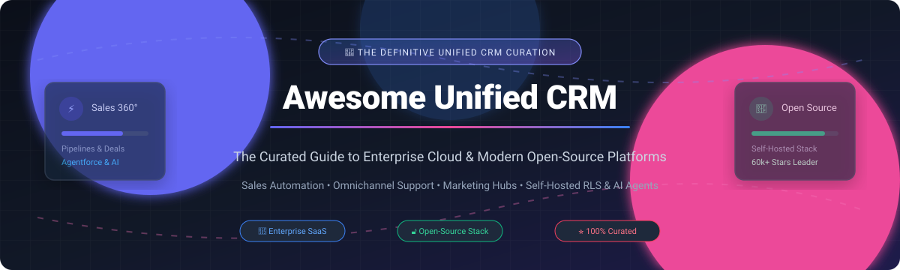

  

# Awesome Unified Customer Relationship Management (CRM) 🌟💼

  
  
  
  
  
  
  

> 🚀 **Awesome Unified Customer Relationship Management (CRM)** is a comprehensive, SEO-optimized, community-curated index of the world's premier **Unified Customer Relationship Management** platforms. Whether evaluating top enterprise cloud SaaS architectures (Salesforce, HubSpot, Dynamics 365) or discovering high-performance self-hosted open-source software (Twenty, Odoo, Chatwoot, Krayin) for omnichannel sales pipelines, marketing automation, service desk workflows, and customer data platforms (CDP)—this guide provides real pricing tiers, verified limits, live star statistics, and architectural benchmarks.
>
> 🌟 **Star this repository if you find it valuable!** 🌟

---

## 📋 Table of Contents 📑

- [🌐 Sector Overview & Market Dynamics](#-sector-overview--market-dynamics-)
- [🏢 SaaS & Hosted Commercial Platforms](#-saas--hosted-commercial-platforms-)
- [🔓 Open-Source Software Platforms](#-open-source-software-platforms-)
  - [1. Twenty](#1-twenty-)
  - [2. Odoo CRM](#2-odoo-crm-)
  - [3. Chatwoot](#3-chatwoot-)
  - [4. Krayin CRM](#4-krayin-crm-)
  - [5. Dolibarr ERP CRM](#5-dolibarr-erp-crm-)
  - [6. Papercups](#6-papercups-)
  - [7. SuiteCRM](#7-suitecrm-)
  - [8. erxes](#8-erxes-)
  - [9. Frappe CRM](#9-frappe-crm-)
  - [10. EspoCRM](#10-espocrm-)
  - [11. BottleCRM](#11-bottlecrm-)
  - [12. Corteza](#12-corteza-)
  - [13. CiviCRM](#13-civicrm-)
- [📊 Feature Comparison Matrix at a Glance](#-feature-comparison-matrix-at-a-glance-)
- [⭐ Star History](#-star-history)
- [💖 Support & Sponsorship](#-support--sponsorship-)
- [🤝 Contributing Guide](#-contributing-guide-)
- [📄 License](#-license-)

---

## 🌐 Sector Overview & Market Dynamics 📈

The global Customer Relationship Management (CRM) industry market size was valued at approximately **$70–$80 Billion in 2024** and is forecasted to surpass **$150+ Billion by 2030–2032**, expanding at a robust **11% to 13% Compound Annual Growth Rate (CAGR)**. Growth drivers include autonomous AI sales agents, native customer data platform (CDP) convergence, generative lead intelligence, and unified multi-channel client lifecycles.

From a competitive landscape perspective, the sector exhibits **bimodal structural characteristics**:
- **High-End Enterprise Tier (Moderately Concentrated):** Dominant titans—namely Salesforce, Microsoft Dynamics 365, Oracle CX, SAP Customer Experience, and HubSpot—command over 50% of aggregate global software revenue through massive partner ecosystems, vertical suites, and integrated ERP architectures.
- **Mid-Market & SMB Segment (Moderately Fragmented):** An expansive array of agile commercial Work OS suites (monday.com, Freshworks, Zoho) compete directly with flexible, developer-friendly open-source frameworks (Twenty, Odoo, Chatwoot, Krayin) offering self-hosted data sovereignty, zero per-seat licensing penalties, and tailored customization.

---

## 🏢 SaaS & Hosted Commercial Platforms ☁️

Curated enterprise-grade cloud CRM suites ranked in **descending order by company valuation / market capitalization**.

| Product | Vendor / Ticker | Company Valuation / Scale | Starting Tier Price 💳 | Free Forever / Trial Limit ⏱️ | Key Capabilities & Highlights 🎯 |
|---|---|---|---|---|---|
| **[Microsoft Dynamics 365](https://dynamics.microsoft.com/)** | Microsoft (`MSFT`) | **~$3.1 Trillion** (Market Cap) | **$65/user/month** (Sales Professional) | **30-day free trial** (up to 25 users, full sample data suite) | 🤖 Deep Copilot & Microsoft 365 integration, enterprise ERP sync, predictive opportunity scoring. |
| **[Oracle CX](https://www.oracle.com/cx/)** | Oracle (`ORCL`) | **~$480 Billion** (Market Cap) | **$65/user/month** (Sales Enterprise Edition) | **30-day free trial** ($300 cloud credits + Always Free Cloud Tier) | 🏛️ Fusion Cloud native; comprehensive B2B/B2C automated buyer journeys and enterprise data pipelines. |
| **[SAP Customer Experience (CX)](https://www.sap.com/products/crm.html)** | SAP (`SAP`) | **~$280 Billion** (Market Cap) | **$58/user/month** (Sales Cloud Standard) | **30-day free trial** (guided enterprise sales scenario tenant) | ⚙️ Mission-critical integration with SAP S/4HANA backbone; end-to-end quote-to-cash workflows. |
| **[Salesforce Customer 360](https://www.salesforce.com/)** | Salesforce (`CRM`) | **~$280 Billion** (Market Cap) | **$25/user/month** (Starter Suite) | **30-day free trial** (Starter Suite, full contact & deal flow access) | 👑 Global market leader; Agentforce AI automation, unified Data Cloud, and thousands of AppExchange add-ons. |
| **[HubSpot CRM Platform](https://www.hubspot.com/)** | HubSpot (`HUBS`) | **~$35 Billion** (Market Cap) | **$15/seat/month** (Starter Customer Platform) | **Free forever plan** (up to 5 users, 1M contacts, deal tracking & Breeze AI) | 🧲 Industry-standard inbound marketing engine, integrated Sales/Marketing/Service Hubs, intuitive UX. |
| **[monday sales CRM](https://monday.com/crm)** | monday.com (`MNDY`) | **~$13 Billion** (Market Cap) | **$12/seat/month** (Basic CRM, min. 3 seats) | **14-day free trial** (Pro tier) + **Free forever Work OS** (up to 2 seats, 1,000 leads) | 📋 Ultra-customizable board views, drag-and-drop workflow automations, and live pipeline dashboards. |
| **[Freshworks Unified CRM](https://www.freshworks.com/crm/)** | Freshworks (`FRSH`) | **~$4.5 Billion** (Market Cap) | **$9/user/month** (Freshsales Growth, billed annually) | **21-day free trial** (Pro features) + **Free forever tier** (up to 3 users, contact & deal flow) | ⚡ Freddy AI assistance, omnichannel customer context, and seamless transition from support ticket to sales deal. |
| **[Zoho One / Zoho CRM](https://www.zoho.com/crm/)** | Zoho Corporation | **~$5 Billion+** (Private Valuation) | **$14/user/month** (Zoho CRM Standard) | **Free forever plan** (up to 3 users, core lead, contact & deal management) | 💼 Unbeatable value for SMBs; Zoho One bundles 45+ applications spanning CRM, invoicing, desk, and HR. |
| **[SugarCRM](https://www.sugarcrm.com/)** | Accel-KKR | **~$600 Million+** (Private Valuation) | **$49/user/month** (Sugar Sell Essentials, min. 3 seats) | **7-day free trial** (full sandbox preview across Sell and Serve) | 🛡️ High-flexibility cloud/on-prem deployments with open-source heritage, automated journey tracking, and AI forecasting. |
| **[Bitrix24](https://www.bitrix24.com/)** | Bitrix, Inc. | **~$200 Million+** (Private Valuation) | **$49/month flat** (Basic tier, up to 5 users total) | **Free forever plan** (unlimited users, 5 GB cloud storage, deals, chat & video) | 💬 Hybrid collaboration hub merging pipeline management with internal chats, HD videoconferencing, and project tasks. |

---

## 🔓 Open-Source Software Platforms 💻

Self-hosted, transparent, community-supported CRM projects ranked strictly in **descending order by GitHub stargazers count**.

### 1. Twenty 🌟
  
**Stack:** TypeScript / NestJS / React / PostgreSQL | **License:** AGPL-3.0 (core) / MIT (SDK)  
Twenty is hailed as the flagship modern open-source alternative to Salesforce and HubSpot. It features a slick, high-performance UI, developer-first APIs (REST & GraphQL), customizable relational models, visual workflow automation, and AI agents. Database schema objects can be defined as code using the Twenty SDK and version-controlled with Git.  
🎯 **Best For:** Engineering teams looking for a modern, extensible CRM codebase without per-seat licensing penalties.

### 2. Odoo CRM 🌟
  
**Stack:** Python / PostgreSQL / OWL JavaScript | **License:** LGPL-3.0 (Community)  
Odoo CRM is a primary module within the expansive Odoo business suite. It provides intuitive Kanban pipeline tracking, automated lead generation via website visitor tracking, VoIP integration, email campaign synchronization, and instant quote generation tied to live warehouse inventory.  
🎯 **Best For:** Companies needing CRM tightly unified with open-source ERP (invoicing, accounting, warehousing, and HR).

### 3. Chatwoot 🌟
  
**Stack:** Ruby on Rails / Vue.js / PostgreSQL / Redis | **License:** AGPL-3.0  
Chatwoot is a premier open-source customer communication suite and support-led CRM alternative to Intercom, Zendesk, and Drift. It aggregates communications from live chat widgets, WhatsApp, Facebook, Instagram, Twitter/X, Telegram, and Email into a unified multi-brand inbox featuring contact attributes, custom bot automations, and team performance metrics.  
🎯 **Best For:** Real-time customer support, inbound lead engagement, and omnichannel conversational messaging.

### 4. Krayin CRM 🌟
  
**Stack:** PHP / Laravel / MySQL | **License:** MIT  
Krayin is a clean, modular CRM built entirely upon the robust Laravel PHP framework. It provides visual Kanban deal pipelines, automated email parsing, customer activity scheduling, custom attribute builders, and access controls under a 100% permissive MIT license.  
🎯 **Best For:** Laravel developers, web agencies, and businesses demanding an unencumbered MIT-licensed CRM foundation.

### 5. Dolibarr ERP CRM 🌟
  
**Stack:** PHP / MySQL / MariaDB | **License:** GPL-3.0  
Dolibarr is a mature, all-in-one ERP and CRM solution tailored for small-to-medium enterprises, foundations, and solo entrepreneurs. It covers customer and prospect accounts, quotes, orders, commercial proposals, point-of-sale (POS), billing, and double-entry bookkeeping without demanding heavy server infrastructure.  
🎯 **Best For:** SMBs and freelancers seeking a lightweight, modular all-in-one business management platform.

### 6. Papercups 🌟
  
**Stack:** Elixir / Phoenix / React / PostgreSQL | **License:** MIT  
Papercups is an open-source conversational customer engagement system designed to bridge customer relationships straight into Slack. Support reps and sales agents can converse with web visitors and manage customer records directly inside internal Slack channels.  
🎯 **Best For:** Modern SaaS teams seeking native Slack-to-customer chat synchronization and contact timeline tracking.

### 7. SuiteCRM 🌟
  
**Stack:** PHP / MySQL / MariaDB | **License:** AGPL-3.0  
The venerable open-source continuation of SugarCRM Community Edition, SuiteCRM delivers comprehensive enterprise CRM capabilities including complex account hierarchies, quote and contract management, automated workflow triggers, customer self-service portals, and rich reporting.  
🎯 **Best For:** Organizations with existing SugarCRM/SuiteCRM workflows seeking enterprise feature depth and data ownership.

### 8. erxes 🌟
  
**Stack:** TypeScript / Node.js / React / GraphQL / MongoDB | **License:** GPL-3.0  
erxes is an open-source Customer Experience (CX) operating system combining marketing automation, sales pipelines, service desk, shared inboxes, and user engagement into a unified plugin ecosystem.  
🎯 **Best For:** Growth marketers and businesses wanting an integrated marketing-to-sales funnel engine.

### 9. Frappe CRM 🌟
  
**Stack:** Python / Frappe Framework / Vue.js / MariaDB | **License:** GPL-3.0  
Frappe CRM brings a clean, reactive single-page app interface to the Frappe/ERPNext ecosystem. It delivers automated lead routing, deal stages, email integration, call logs, and instant connectivity to ERPNext's manufacturing, inventory, and accounting modules.  
🎯 **Best For:** Organizations already utilizing or evaluating ERPNext and the Frappe ecosystem.

### 10. EspoCRM 🌟
  
**Stack:** PHP / MySQL / Vanilla JS SPA | **License:** AGPL-3.0  
EspoCRM is a lightweight, responsive open-source CRM application. Its built-in Entity Manager allows administrators to configure custom relational objects, fields, layouts, and role permissions directly from the browser without writing code.  
🎯 **Best For:** Teams wanting an agile, classic CRM with powerful visual entity modeling and straightforward REST APIs.

### 11. BottleCRM 🌟
  
**Stack:** Python / Django REST / SvelteKit / Flutter / PostgreSQL | **License:** MIT  
BottleCRM (formerly Django-CRM) is an open-source, multi-tenant CRM engine featuring native **PostgreSQL Row-Level Security (RLS)**. It bundles customer pipelines, support ticketing (SLA timers, escalations, knowledge base), and native cross-platform Flutter mobile applications for iOS and Android.  
🎯 **Best For:** Python/Django shops seeking native mobile apps, database-level multi-tenancy, and AI-agent-ready REST endpoints.

### 12. Corteza 🌟
  
**Stack:** Go / Vue.js / PostgreSQL | **License:** Apache-2.0  
Corteza is an enterprise low-code platform functioning as a 100% open-source alternative to Salesforce. It features preconfigured CRM templates, drag-and-drop record page builders, business process workflow automation (Corredor), and granular RBAC permissions.  
🎯 **Best For:** Enterprises requiring an Apache-2.0 licensed low-code foundation to design custom CRM applications.

### 13. CiviCRM 🌟
  
**Stack:** PHP / MySQL | **License:** AGPL-3.0  
CiviCRM is a constituent relationship management platform purpose-built for non-profits, NGOs, charities, and political campaigns. Rather than commercial deal closing, it optimizes donor management, pledge tracking, event ticketing, membership dues, and advocacy mailings.  
🎯 **Best For:** Nonprofits, associations, and public-interest groups needing donor and civic engagement management.

---

## 📊 Feature Comparison Matrix at a Glance 🔍

| Software Solution | License Type | Deployment Model | Multi-Tenant Architecture | Native Mobile App | Self-Hosted Support | Primary Sweet Spot |
|---|---|---|---|---|---|---|
| **Salesforce Customer 360** | Proprietary | Cloud | ✅ | ✅ (iOS/Android) | ❌ | Enterprise CRM, custom apps & Agentforce AI |
| **HubSpot CRM Platform** | Proprietary | Cloud | ✅ | ✅ (iOS/Android) | ❌ | Inbound marketing engine & intuitive sales |
| **Microsoft Dynamics 365** | Proprietary | Cloud / Hybrid | ✅ | ✅ (iOS/Android) | ❌ | Microsoft 365 ecosystem & enterprise ERP |
| **Oracle CX Cloud** | Proprietary | Cloud | ✅ | ✅ (iOS/Android) | ❌ | Oracle-centric enterprise ecosystems |
| **SAP Customer Experience** | Proprietary | Cloud / Hybrid | ✅ | ✅ (iOS/Android) | ❌ | Deep SAP S/4HANA backbone sync |
| **Zoho One / Zoho CRM** | Proprietary | Cloud | ✅ | ✅ (iOS/Android) | ❌ | Maximum SMB software breadth at flat price |
| **Freshworks Unified CRM** | Proprietary | Cloud | ✅ | ✅ (iOS/Android) | ❌ | Omnichannel mid-market CRM & Freddy AI |
| **monday sales CRM** | Proprietary | Cloud | ✅ | ✅ (iOS/Android) | ❌ | Highly visual Work OS pipeline customization |
| **SugarCRM** | Proprietary | Cloud / On-Prem | ✅ | ✅ (iOS/Android) | ❌ | High data control & enterprise customization |
| **Bitrix24** | Proprietary | Cloud / On-Prem | ✅ | ✅ (iOS/Android) | ❌ | Free tier CRM + chat & video collaboration |
| **Twenty** | AGPL-3.0 / MIT | Cloud / Self-Hosted | ✅ | ❌ (Web/PWA) | ✅ | Modern code-defined Salesforce alternative |
| **Odoo CRM** | LGPL-3.0 | Cloud / Self-Hosted | ✅ | ✅ (iOS/Android) | ✅ | All-in-one ERP and business operations |
| **Chatwoot** | AGPL-3.0 | Cloud / Self-Hosted | ✅ | ✅ (iOS/Android) | ✅ | Omnichannel customer messaging & inbox |
| **Krayin CRM** | MIT | Self-Hosted | ✅ | ❌ (Web/PWA) | ✅ | Permissive Laravel developer CRM |
| **Dolibarr ERP CRM** | GPL-3.0 | Self-Hosted | ✅ | ❌ (Web/PWA) | ✅ | Lightweight SMB ERP + CRM suite |
| **Papercups** | MIT | Cloud / Self-Hosted | ✅ | ❌ (Slack-based) | ✅ | Slack-integrated customer messaging |
| **SuiteCRM** | AGPL-3.0 | Self-Hosted | ✅ | ⚠️ (Community) | ✅ | Proven legacy enterprise workflows |
| **erxes** | GPL-3.0 | Cloud / Self-Hosted | ✅ | ❌ (Web/PWA) | ✅ | Growth marketing & CX operations |
| **Frappe CRM** | GPL-3.0 | Cloud / Self-Hosted | ✅ | ❌ (Web/PWA) | ✅ | Integrated Frappe / ERPNext ecosystem |
| **EspoCRM** | AGPL-3.0 | Self-Hosted | ✅ | ❌ (Web/PWA) | ✅ | Intuitive classic CRM with visual Entity Manager |
| **BottleCRM** | MIT | Self-Hosted | ✅ (Postgres RLS) | ✅ (Flutter native) | ✅ | Permissive MIT, multi-tenant & mobile apps |
| **Corteza** | Apache-2.0 | Self-Hosted | ✅ | ❌ (Web/PWA) | ✅ | 100% Apache low-code platform builder |
| **CiviCRM** | AGPL-3.0 | Self-Hosted | ✅ | ❌ (Web/PWA) | ✅ | Donor, NGO, and member constituent CRM |

---

## 💖 Support & Sponsorship ☕

If you find this curated unified CRM guide useful for your startup, enterprise evaluation, or development workflows, please consider supporting the project:

- ⭐ **Star this repository** to help others discover it across GitHub.
- 🍴 **Fork the repo** to save your personal notes and customized benchmarks.
- 📢 **Share with your colleagues** on LinkedIn, X/Twitter, Reddit, or Discord.
- ☕ **Buy a coffee & sponsor ongoing curation:**  
  

Your support keeps this directory accurate, up-to-date, and independent! Thank you! 🙌

---

## ⭐ Star History

---

## 🤝 Contributing Guide 🛠️

Contributions are warmly welcomed! If you know of an innovative SaaS platform or active open-source CRM that deserves a place in this curation, please feel free to submit a Pull Request.

### Guidelines for Submissions:
1. **Quality & Activity:** The project must be actively maintained (recent releases/commits within the past 12 months).
2. **Open Source Authenticity:** Open-source entries must have public source repositories with recognized OSI or open licenses.
3. **Structured Format:** Follow the standard format including project name, website/repo link, star badge, technology stack, license, and brief description.
4. **Awesome Master List:** Check out the parent curation list at [Awesome-Awesome-Awesome](https://github.com/ishandutta2007/Awesome-Awesome-Awesome) for more curated tech stacks.

---

## 📄 License ⚖️

This curated compilation is dedicated to the public domain under the [Creative Commons Zero v1.0 Universal](https://creativecommons.org/publicdomain/zero/1.0/) (CC0 1.0) license. All individual product names, logos, and trademarks belong to their respective corporate and open-source owners.

---

  <b>Built with ❤️ by the community. Star ⭐ this repository if it helped your tech stack decision!</b>

